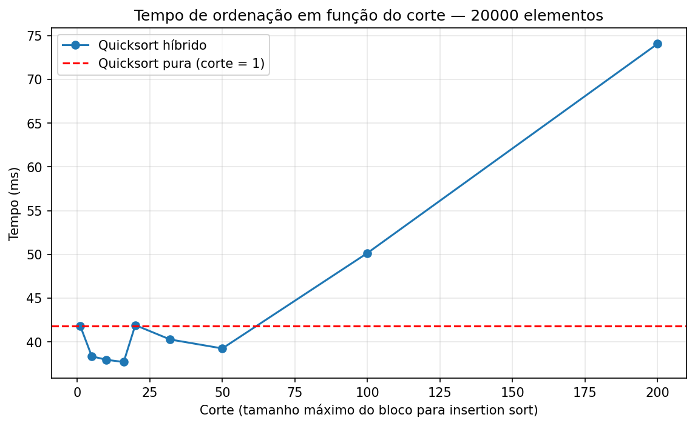

# Relatório: Quicksort híbrido com insertion sort

Foram ordenados **20000** números inteiros aleatórios. O algoritmo usa **pivô aleatório**, partição em **menores, iguais e maiores** e troca para **insertion sort** quando um bloco tem tamanho menor ou igual ao corte.

Cada configuração foi executada 5 vezes; a tabela mostra o menor tempo observado.

## Tabela de tempos

| Corte | Tempo (s) | Ganho sobre a quicksort pura |
|---:|---:|---:|
| 1 | 0.04185 | +0.00% |
| 5 | 0.03836 | +8.35% |
| 10 | 0.03796 | +9.30% |
| 16 | 0.03771 | +9.90% |
| 20 | 0.04192 | -0.17% |
| 32 | 0.04028 | +3.75% |
| 50 | 0.03925 | +6.20% |
| 100 | 0.05015 | -19.85% |
| 200 | 0.07406 | -76.98% |

## Gráfico

O gráfico mostra o tempo de execução para cada valor de corte. A linha vermelha representa a quicksort pura, equivalente ao corte igual a 1.

## Melhor corte

O melhor tempo foi obtido com **corte = 16**, levando **0.03771 segundos**.

Em relação à quicksort pura, o ganho foi de **9.90%** de redução no tempo.

## Cortes grandes demais

Com cortes muito grandes, o insertion sort passa a ordenar blocos grandes. Como o insertion sort tem custo quadrático, ele faz muitas comparações e deslocamentos. Por isso, após certo ponto, o tempo volta a subir e o algoritmo pode ficar mais lento que a quicksort pura.

## Confirmação do corte = 1

Com **corte = 1**, o insertion sort só é chamado para blocos de tamanho 1, que já estão ordenados. Portanto, o algoritmo se comporta exatamente como a **quicksort pura** com pivô aleatório e partição em menores, iguais e maiores. Isso aparece na tabela: o corte 1 tem o mesmo tempo da quicksort pura.
